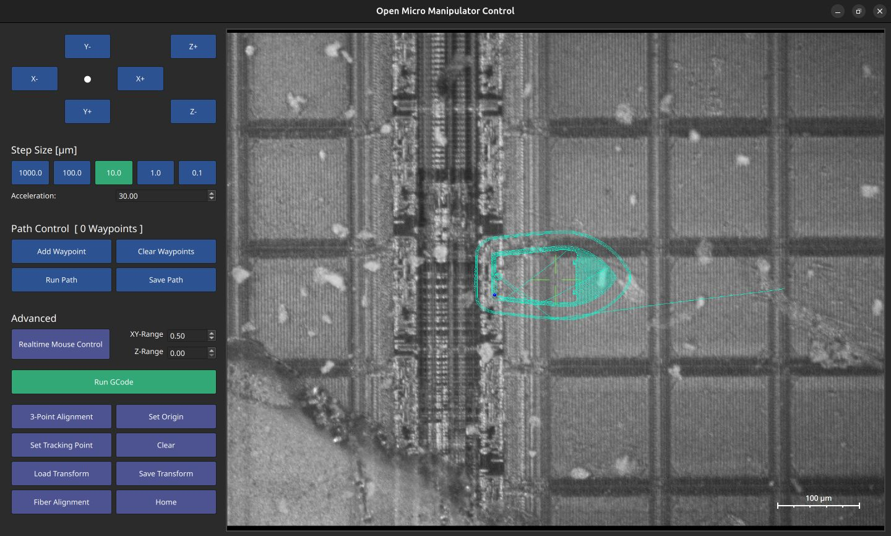
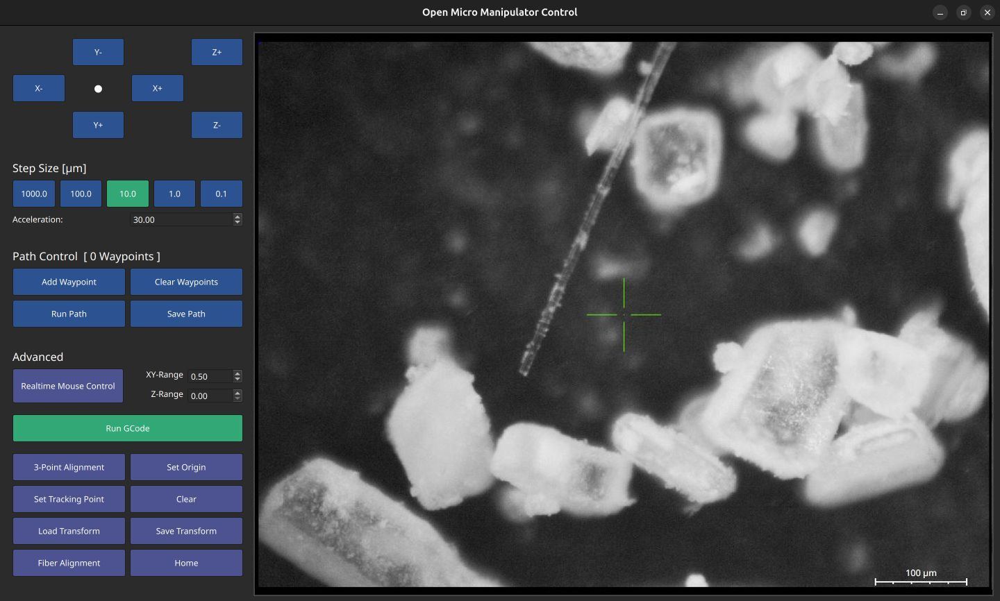

# Open Micro-Manipulator GUI

**Open Micro-Manipulator GUI** is a small graphical user interface for controlling the [Open Micro-Manipulator](https://github.com/0x23/MicroManipulatorStepper), featuring a live microscope camera view for real-time feedback.
You  can find the Open Micro-Manipulator repository.
  

  
  

## ✨New Version 0.1.3

The version incudes several general improvements, controlls for the tool output and changes to the g-code parser to support the **Fiber Immersion Micro 3D-Printing Method**.

## ⬇️ Installation

1. Clone the repository and navigate into the project directory.
2. Install the required Python dependencies: `pip install -r requirements.txt`
3. Run the application: `python source/main.py`

Make sure you are using a compatible Python version and that your hardware is properly connected before launching the GUI.

## 🔧 Device Selection

The GUI now lists available serial devices and cameras directly in the interface. Use the `Refresh`, `Connect`, and `Disconnect` controls to manage the micromanipulator and camera at runtime.

## 📷 Camera

The program can display a live camera feed using the open-cv image capturing framework. For best experience I recommend a camera capable of capturing 60 frames per second (also make sure you are not limited by the cameras shutter time).

## 3-Point Alignment

Computes a workspace transformation that aligns three points to the XY plane. This is useful for microscopy to get the sample plane to stay in focus in case of slight misalignments.
Usage: Set three wayoints spanning a triangle (points must not be on a line) in the XY plane and set the Z height (e.g. so that the sample is in focus at each point). Then press the '3-Point Alignment button'.

## 🧾 Running G-Code

The whole file is checked before anything moves. Unsupported or malformed lines stop the run with the line number instead of being ignored.

| Supported | Meaning |
|---|---|
| `G0`/`G1` `X Y Z A F E` | absolute move; `A` = focus axis (stage idle and tools off first); `F` in units/min |
| `G4 P`/`S` | dwell in milliseconds / seconds |
| `M3 T S`, `M5 T` | tool output 0..1 (T = 0 or 1) / off; modal, applied with the next move |
| `M82`/`M83`, `G92 E` | extrusion mode for the fiber method |
| `M2`/`M30` | program end |
| `G17 G21 G40 G49 G54 G80 G90` | accepted modal settings (`G21` selects mm if no `SCALE` was given) |
| `;` and `( )` comments | ignored |

Rejected: arcs (`G2`/`G3`), `G20`, `G91`, `G43`, `M6`, tool selection `T` alone, other codes.
You may press the 'Set Origin' button to set the current device loaction as zero position for running the G-Code.
Start with `--simulate-focus` to run the focus axis in simulation; without it, the focus axis uses Raspberry Pi GPIO (lgpio) or reports itself unavailable.

> ⚠️ **Warning**  
> Running G-Code that exceeds the machine’s physical limits may cause rapid and uncontrolled movements. Use with caution.

### Scaling
A custom scaling directive can be added at the beginning of a G-Code file: `SCALE=0.123` (or per axis: `SCALE X0.1 Y0.1 Z0.1 A1 F0.1`).
Without `SCALE` or `G21`, numbers are read as micrometres (scale 0.001). Paths saved by this GUI start with `SCALE=1`; files saved by older versions lack it and need `SCALE=1` added as the first line.

### Tests

`pip install -r requirements-dev.txt`, then `python -m pytest tests -q`. See `../NEW_docs/` for the write-ups.

