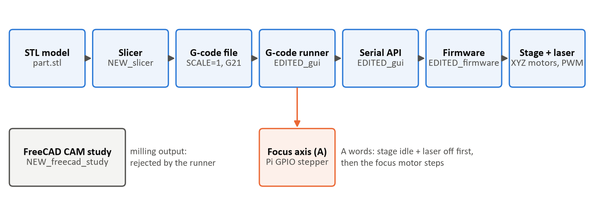

# XYZ Micro-Manipulator: Slicer, 4th Focus Axis and FreeCAD Study

Senior design software work for the XYZ micro-manipulator: a corrected STL slicer, a separately controlled 4th (focus) axis in the GUI and G-code workflow, the FreeCAD CAM study (Item 8), and the firmware fixes those need.



## Folder layout

Top-level folder names show what happened to each part.

| Folder | Status | What it is |
|---|---|---|
| `EDITED_gui/` | edited | PySide6 control GUI with the focus axis, strict G-code runner and serial API (`source/`), plus 102 tests (`tests/`) |
| `EDITED_firmware/` | edited | RP2350 motion-controller firmware (PlatformIO project) |
| `NEW_slicer/` | new | `pbm_slicer.py` STL → G-code slicer, `verify_gcode.py`, 34 tests, `examples/` |
| `NEW_freecad_study/` | new | Item 8: FreeCAD project, its milling G-code, and the FreeCAD 1.0.2 rerun evidence |
| `NEW_docs/` | new | Write-ups, demonstration guide (`.md` and `.docx`), firmware build log, `images/` |
| `UNCHANGED_reference/` | unchanged | CAD (`construction`), `electronics`, `datasheets`, original `documentation`, `python_api`, `encoder_field_sim`, the embossing-machine project, team documents |

## New and edited code files

Code files keep their real names so imports and `#include`s work. This table is the label.

| Status | Files |
|---|---|
| **New** | `EDITED_gui/source/gcode_program.py`, `EDITED_gui/source/hardware/focus_axis.py`, `EDITED_gui/source/version.py`, `EDITED_gui/tests/*`, `EDITED_gui/requirements-dev.txt`, everything in `NEW_slicer/`, `NEW_freecad_study/`, `NEW_docs/` |
| **Edited** | `EDITED_gui/source/mainwindow.py`, `gcode_runner.py`, `main.py`, `hardware/open_micro_stage_api.py`, `gui_components/realtime_controller_widget.py`, `EDITED_gui/README.md` |
| **Edited (firmware)** | `EDITED_firmware/src/robot.cpp`, `robot.h`, `motion_control/motion_controller.cpp/.h`, `motion_control/path_segment.cpp`, `servo_control/homing_controller.cpp`, `command_parser/command_parser.cpp` |
| **Restored (firmware)** | `EDITED_firmware/src/version.h`, `src/utilities/{math3d.h, math_constants.h, ringbuffer.h, utilities.h, utilities.cpp, waveforms.h, waveforms.cpp}`, missing from the original copy, taken from upstream MicroManipulatorStepper commit `9d18a57` |

Every change, its reason and how it was verified: [`NEW_docs/correction_report.md`](NEW_docs/correction_report.md).
Where each file from the original GitHub project is now: [`README_CHANGES.txt`](README_CHANGES.txt).

## Quick start (Windows)

```
cd EDITED_gui
setup.bat
.venv\Scripts\python.exe -m pip install -r requirements-dev.txt
.venv\Scripts\python.exe source\main.py --simulate-focus
.venv\Scripts\python.exe -m pytest tests ..\NEW_slicer\tests -q
```

Slicer: `cd NEW_slicer` then `python pbm_slicer.py examples\block_with_hole.stl --preview`.
Firmware: open `EDITED_firmware` in VS Code with PlatformIO and build (needs Git with long paths enabled).

## Verification status

| Check | Result |
|---|---|
| Automated tests (pytest + pytest-qt) | 136 passed |
| Firmware build (`pio run -e pico`) | SUCCESS, RAM 4.9 %, flash 3.3 % (not flashed) |
| FreeCAD 1.0.2 rerun of the Item 8 job | Output identical to the stored G-code |
| GUI launch with `--simulate-focus` | Starts and runs |
| Hardware (stage, laser, Pi, focus motor) | **Not tested yet**; see `NEW_docs/fourth_axis_gui_writeup.md` |

## Documents

| Document | Content |
|---|---|
| [`NEW_docs/demonstration_guide.docx`](NEW_docs/demonstration_guide.docx) / [`.md`](NEW_docs/demonstration_guide.md) | Folder-by-folder guide: how, why, how to test, expected results, software |
| [`NEW_docs/item8_freecad_summary.md`](NEW_docs/item8_freecad_summary.md) | Item 8 FreeCAD CAM study summary |
| [`NEW_docs/slicer_writeup.md`](NEW_docs/slicer_writeup.md) | Slicer write-up |
| [`NEW_docs/fourth_axis_gui_writeup.md`](NEW_docs/fourth_axis_gui_writeup.md) | 4th-axis GUI write-up and physical checklist |
| [`NEW_docs/setup_and_verification.md`](NEW_docs/setup_and_verification.md) | Setup and reproduction commands |
| [`NEW_docs/correction_report.md`](NEW_docs/correction_report.md) | Problem → evidence → fix → verification |

## License

The GUI and firmware are based on the MIT-licensed Open Micro-Manipulator project; the original license headers are kept in those files (see `EDITED_gui/LICENSE`).
